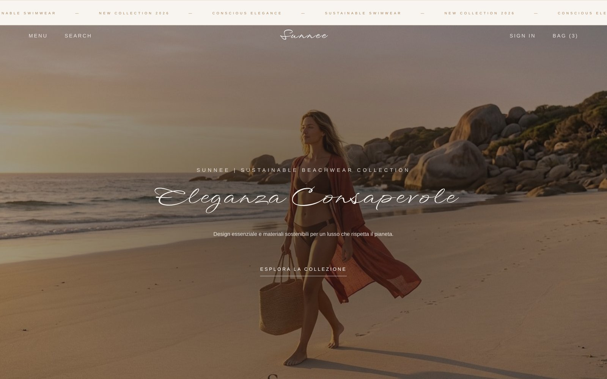
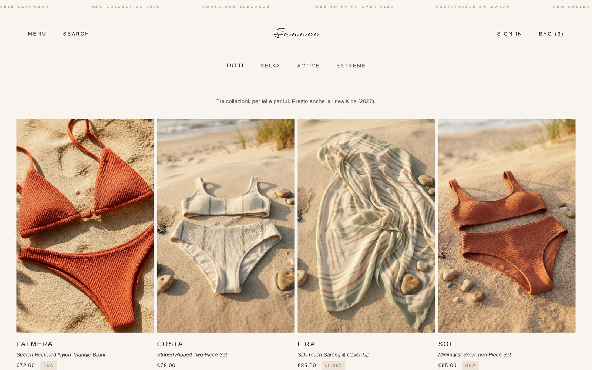
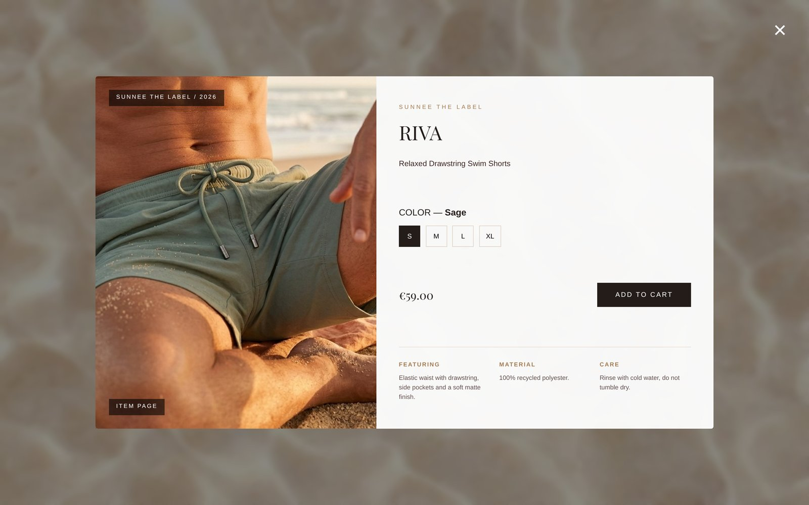
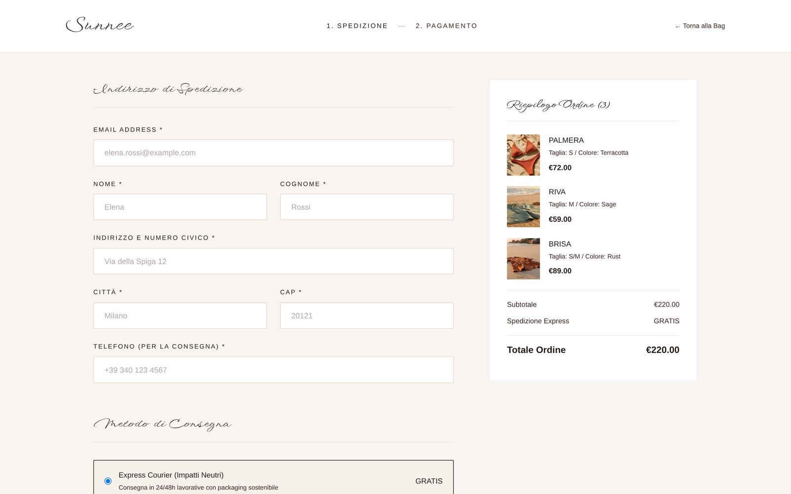
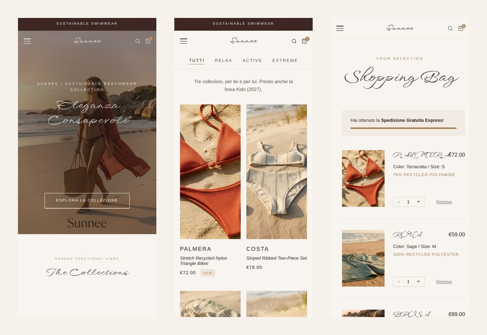

# Sunnee — Sustainable Beachwear

E-commerce **simulato** per un brand di costumi da bagno sostenibili, realizzato in HTML, SCSS e JavaScript vanilla.
Non c'è un backend: login, borsa, checkout e ordini sono simulati nel browser, ma l'esperienza d'acquisto è completa dall'inizio alla fine.

🔗 **Demo online:** _(link GitHub Pages — da aggiungere)_




| Shop | Scheda prodotto |
|---|---|
|  |  |

| Checkout | Mobile |
|---|---|
|  |  |


---

## Il brand

Sunnee produce beachwear con tessuti riciclati (nylon e plastica recuperata dagli oceani).
Il catalogo è organizzato in **tre collezioni**, ognuna con capi da donna e da uomo, più una linea **Kids** in arrivo nel 2027:

| Collezione | Per chi |
|---|---|
| **Relax** | comfort e vestibilità essenziale per il mare di tutti i giorni |
| **Active** | sostegno e libertà di movimento per gli sport acquatici |
| **Extreme** | capi tecnici per atleti e surfisti professionisti |

## Cosa si può fare sul sito

- **Shop** con filtri per collezione, card con foto al passaggio del mouse e scheda prodotto (colore, taglie, materiali, cura del capo)
- **Home** con moodboard e *Quick View* generate dagli stessi dati dello Shop
- **Borsa vera**: aggiunta con taglia, quantità, rimozione, totali e barra per la spedizione gratuita (da €150). Resta salvata anche chiudendo il browser
- **Checkout** con riepilogo, scelta della spedizione, metodo di pagamento, validazione dei campi e numero d'ordine generato
- **Area account** simulata: login/registrazione, ordini con dettagli, modifica indirizzo e profilo, password dimenticata
- **FAQ** ad accordion, pagine **Privacy** e **Termini**
- Menu laterale, ricerca e contatore della borsa su tutte le pagine
- Layout **responsive** per desktop e mobile

## Tecnologie

- **HTML5** semantico
- **SCSS** (variabili condivise in `_variables.scss`, un file per pagina), compilato in CSS
- **JavaScript vanilla**, senza librerie:
  - catalogo in un unico file dati (`products.js`) da cui vengono generate le pagine
  - manipolazione del DOM ed event delegation
  - `localStorage` per la borsa, sincronizzata tra le schede aperte
  - parametri nell'URL (`shop.html?c=relax`, `shop.html?p=palmera`) per aprire collezioni e prodotti direttamente

## Struttura del progetto

```
Sunnee/
├── index.html, shop.html, about.html, faq.html,
│   account.html, bag.html, checkout.html, privacy.html, terms.html
└── assets/
    ├── scss/      sorgenti degli stili
    ├── css/       CSS compilato (generato: non si modifica a mano)
    ├── js/        main.js (comune) · products.js (catalogo) · uno script per pagina
    ├── images/    brand · backgrounds · products · models · lookbook · readme
    └── favicon/
```

### Aggiungere un prodotto

Basta aggiungere un oggetto all'array `PRODUCTS` in `assets/js/products.js`: Shop, Home, borsa e checkout lo mostrano da soli.

```js
{
    "id": "riva",
    "title": "RIVA",
    "price": 59,
    "collection": "relax",   // relax | active | extreme
    "gender": "uomo",        // donna | uomo | unisex
    "img": "assets/images/products/set10.jpg",
    "sizes": ["S", "M", "L", "XL"],
    ...
}
```

## Come aprirlo in locale

1. Scarica o clona il repository
2. Apri `index.html` nel browser (oppure usa l'estensione **Live Server** di VS Code)
3. Per modificare gli stili, cambia i file in `assets/scss/` e ricompila:
   ```
   npx sass --no-source-map assets/scss:assets/css
   ```
   (in alternativa, l'estensione **Live Sass Compiler** di VS Code, già configurata per salvare in `assets/css/`)
     
     

## Cosa ho imparato

Lavorare a questo progetto senza framework o librerie esterne è stata un'ottima palestra per consolidare le basi del web development:

- **Separazione tra dati e presentazione:** tutti i prodotti vivono in `products.js` e le pagine vengono generate da lì. Basta aggiungere un oggetto per aggiornare Shop, Home, borsa e checkout, senza toccare l'HTML.
- **Gestione dello stato con `localStorage`:** sviluppando il carrello ho ragionato su come i dati passano da una pagina all'altra e su come tenerli sincronizzati anche tra più schede aperte (evento `storage`), simulando un'esperienza e-commerce completa senza backend.
- **SCSS ben strutturato:** variabili condivise in `_variables.scss` e un file per pagina, per evitare duplicazioni e mantenere coerenza visiva su tutte le pagine e su mobile.
- **Parametri nell'URL:** con `URLSearchParams` un link può aprire direttamente una collezione (`shop.html?c=relax`) o un prodotto (`shop.html?p=palmera`).
- **Event delegation:** un solo listener sul contenitore gestisce anche gli elementi creati dinamicamente da JavaScript, come le righe della borsa.
- **Un bug che mi ha insegnato qualcosa:** lo stile delle opzioni di pagamento non veniva applicato. Il motivo era che il contenitore aveva un nome di classe diverso nell'HTML (`.payment-tabs`) e nell'SCSS (`.payment-selector-box`). Da allora, quando uno stile "non funziona", controllo per prima cosa che i selettori coincidano.


## Note

- Progetto realizzato a scopo didattico e per portfolio: **nessun pagamento è reale** e nessun dato viene inviato.
- Le immagini di prodotti e modelli sono generate con intelligenza artificiale a scopo dimostrativo.
- Icone: [SVG Repo](https://www.svgrepo.com). Font: [Google Fonts](https://fonts.google.com) (Playfair Display SC, Montserrat, WindSong).

---

Realizzato da **Angela** · _(link al tuo portfolio o LinkedIn)_
